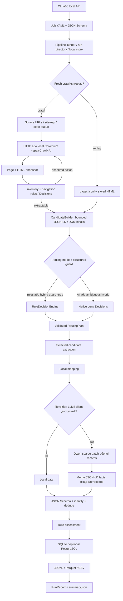
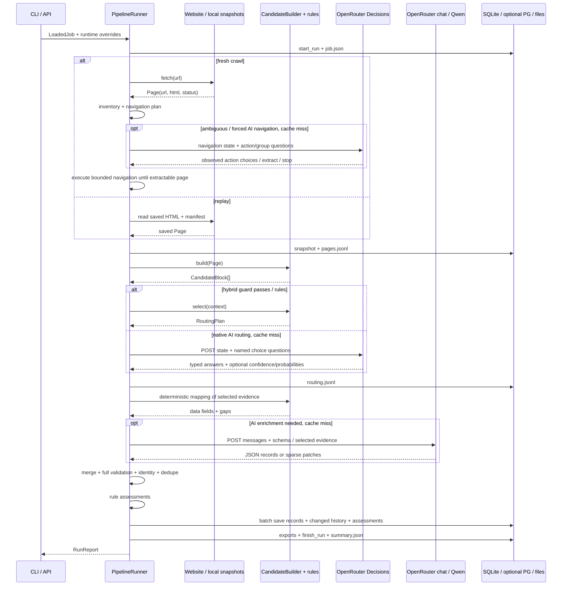

# Unified Web Parser: повний шлях даних і запитів

Цей документ пояснює **реалізований pipeline**: який код запускається, що отримує кожен
етап, що повертає, де відбувається мережевий запит і які файли залишаються після запуску.
Опис спирається на модулі репозиторію; automatic plugin registry немає.
Типовий extraction тепер `generic`; товарні евристики та device assessment винесені
в явно обрані [предметні профілі](domain-profiles.md). Старі товарні traces нижче
залишаються прикладами конкретних завдань, а не вимогами до будь-якого запису.
**Навігацію оновлено:** поточна поведінка, команди, session/state graph і AI-етапи
описані в [navigation.md](navigation.md). Розділи 10/11 нижче оновлені; OLX trace у §24
залишено історичним і він не доводить поведінку нового navigation planner.
Пошук джерел від питання без заданих URL — [discovery.md](discovery.md);
він додає query planning і web search перед звичайним обходом. Поточний discovery
об'єднує кілька видач за зареєстрованим доменом, починає з кореня кожного сайту
та використовує текстовий пошук без автоматичних фільтрів. Старі traces нижче
відображають поведінку своїх запусків, а не нові типові параметри discovery.
Пошуковий API мігровано на `openrouter:web_search` Server Tool: обмеження виконання,
перевірка usage, кеш і приклад запиту наведені в [discovery.md](discovery.md#контракт-server-tool).
У `discover` і `search --source` без `--config` перед цим також створюється схема з питання:
[автоматична генерація схеми](schema-generation.md). Явний профіль зберігає свою схему.

Для швидкого встановлення є [основний README](../README.md), для вимірювання витрат —
[cost optimization](cost-optimization.md). Тут розглядається весь процес, включно з wire payloads.

## Зміст

1. [Що саме робить система](#purpose)
2. [Як читати реальний trace](#trace-provenance)
3. [Дві схеми виконання](#diagrams)
4. [Що виконується локально, що в мережі та що оплачується](#execution-map)
5. [Точки входу: команди й локальний API](#entrypoints)
6. [CLI, dotenv, конфігурація та JSON Schema](#configuration)
7. [Точні default limits і налаштування моделей](#defaults)
8. [Контракти даних між етапами](#contracts)
9. [Створення запуску та його ресурсів](#run-start)
10. [Пошукові URL, sitemap і черга сторінок](#discovery)
11. [HTTP або browser: що фактично завантажується](#fetching)
12. [Snapshot і manifest сторінок](#snapshots)
13. [Як CandidateBuilder знаходить блоки](#candidates)
14. [Як обирається rules або Decisions](#routing)
15. [Native Decisions: точний тип запиту й відповіді](#native-decisions)
16. [Детерміноване витягування JSON-LD та DOM](#deterministic-extraction)
17. [Sparse enrichment та Qwen: точний тип запиту й відповіді](#qwen)
18. [Merge, повна валідація, identity та дедуплікація](#validation-identity)
19. [Assessment: що означають true, false і null](#assessment)
20. [SQLite, PostgreSQL і історія](#storage)
21. [Що потрапляє в JSONL, Parquet і CSV](#exports)
22. [RunReport, помилки, warnings і exit codes](#reports)
23. [Cache і reprocess без нового crawling](#cache-replay)
24. [Покроковий розбір одного справжнього оголошення](#worked-trace)
25. [API, діагностика, розширення та поточні межі](#operations)

<a id="purpose"></a>
## 1. Що саме робить система

Завдання задає джерела, необов'язковий пошуковий рядок, JSON Schema результату,
ліміти crawling/AI та бажані експорти. Рушій намагається отримати schema-valid записи
з цих джерел, зберігаючи зв'язок кожного запису з вихідним контентом.

Поточний приклад — MacBook-моніторинг. Загальна модель `Record` не містить полів
`chip`, `ram_gb` чи `mdm_status`: вони живуть у [MacBook JSON Schema](../configs/schemas/macbook.schema.json).
Вакансії чи новини можуть мати іншу схему, але generic mapping не гарантує, що кожне
довільне поле буде знайдене без LLM або додаткової стратегії extraction.

Є два окремі decision-етапи: navigation обирає спостережувані дії на сайті,
а block routing — **вже знайдені блоки й спосіб їх розбору**.
Спочатку локальний `CandidateBuilder` створює інвентар блоків. Лише потім rules або
native Decisions вирішує: `json_ld`, `dom`, `llm` чи `skip`.
Decision Engine не завантажує сайт, не бачить довільний повний DOM поза переданими блоками,
не генерує CSS-селектори для виконання і не приймає рішення про купівлю.

Позначення `JSON-LD / DOM / LLM` також не означає обов'язкову лінійну fallback-чергу.
Обраний JSON-LD спочатку розбирається локально, а його відсутні поля може доповнити LLM
**з того самого JSON-LD блоку**. DOM — інший можливий target. Автоматичного пошуку
відсутнього JSON-LD поля в DOM цієї сторінки зараз немає.

<a id="trace-provenance"></a>
## 2. Як читати реальний trace

Три versioned JSON-файли дозволяють подивитися на navigation evidence і повні payloads:

- [olx-pipeline-trace.json](examples/olx-pipeline-trace.json) — реальна сторінка, кандидати,
  plan, deterministic data, sparse schema, реконструйований Qwen request, справжній
  validated response із local cache, merged record, assessment і historical summary.
- [olx-native-routing-request.json](examples/olx-native-routing-request.json) — точний
  native request для **альтернативної примусової AI-routing гілки** на тих самих кандидатах.
- [olx-live-navigation.json](examples/olx-live-navigation.json) — шість ordered Page results
  початкового live browser crawl: search page та п'ять detail pages. Це не browser HAR.

Важлива відмінність між джерелами evidence:

| Частина trace | Що це насправді |
| --- | --- |
| HTML, `page`, `candidates`, historical plan/record | Збережені дані справжнього OLX-запуску |
| Historical run `2ae1c7fe189f4e759e252bf77c717574` | Replay п'яти збережених extractable сторінок; нового crawling у ньому не було |
| Qwen request body | Реконструкція через поточний production request builder і `httpx.MockTransport` |
| `model_response_json_from_real_local_cache` | Справжній validated model JSON, знайдений за fingerprint запиту |
| `original_http_response_envelope` | `null`: оригінальний provider HTTP envelope не був збережений |
| Native alternative request | Request reconstruction для `routing: ai`; цей optimized historical run його не відправляв |
| Native `provider_response` | `null`: файл не приписує альтернативній гілці вигадану відповідь |
| Authorization | Лише placeholder; ключ не завантажувався й не записувався |
| Browser CSS/JS/XHR log | Не збережений як HAR; повного списку browser subrequests немає |
| `olx-live-navigation.json` | Реальний давніший live crawl із GPT-4.1 Mini; лише evidence acquisition/order, не один спільний Qwen-run |

Для підготовки цих assets не було мережевих або нових платних AI-запитів.
Усі приклади нижче з позначкою **«скорочений фрагмент»** навмисно опускають частину полів.
Повне джерело завжди вказане JSON field path; короткий приклад не слід копіювати як
повний реальний HTTP body. Концептуальні відповіді позначені окремо й не видаються за trace.

<a id="diagrams"></a>
## 3. Дві схеми виконання

### Загальна схема



### Послідовність для extractable detail page



У цьому diagram cache hit замінює відповідний AI POST локальним читанням JSON.
Створення provider client саме по собі не є model call. У fresh browser режимі один
`fetch(url)` може породити багато внутрішніх HTTP-запитів браузера.

<a id="execution-map"></a>
## 4. Що виконується локально, що в мережі та що оплачується

| Етап | Де працює | Що отримує → що повертає | Платний AI call |
| --- | --- | --- | --- |
| argparse / dotenv / YAML / schema loader | Python на машині запуску | CLI + files → `LoadedJob` | Ні |
| Inventory / rules / sitemap parsing | Локальний Python | Page/XML → observed actions / queue entries | Ні |
| AI navigation cache miss | OpenRouter API → provider моделі | goal/schema/page/actions → action/group/extract/stop | Так |
| `HttpFetcher` | Python + мережа до сайту | URL → `Page` | Ні |
| `Crawl4AIFetcher` | Локальний Chromium + мережа до сайту | URL → rendered HTML у `Page` | Ні |
| Snapshot / CandidateBuilder | Локальний диск/CPU | `Page` → saved HTML + candidates | Ні |
| Structured guard / rules routing | Локальний Python | `RoutingContext` → `RoutingPlan` | Ні |
| Native Decisions cache miss | OpenRouter API → provider моделі | `state`, `questions` → typed `answers` | Так |
| JSON-LD / DOM mapping | Локальний Python | selected content + schema → partial data | Ні |
| Qwen cache miss | OpenRouter chat API → provider моделі | selected content + schema → JSON | Так |
| JSON Schema / merge / dedupe / assessment | Локальний Python | records → validated records / rule results | Ні |
| SQLite | Локальний файл | batch → current/history tables | Ні |
| PostgreSQL | DB connection до `DATABASE_URL` | batch → SQL/JSONB tables | Ні, але може бути окрема ціна інфраструктури |
| JSONL / CSV / Parquet | Локальний диск | record envelopes → files | Ні |

`max_calls` обмежує **AI HTTP attempts**, а не долари, browser requests чи crawl retries.
Витрати crawling/browser/CPU/storage не включені в token estimate benchmark.
Navigation, native routing і extraction ділять один `RequestBudget` та окремо враховуються
в `summary.ai.stages`, коли відповідні клієнти створені. Rules/replay/no-AI можуть
не мати частини stage entries або всього AI-звіту. Navigation і routing типово
використовують ту саму decision-модель.

<a id="entrypoints"></a>
## 5. Точки входу: команди й локальний API

Реалізація: [CLI entry point](../src/unified_web_parser/interfaces/cli/__init__.py), [аргументи](../src/unified_web_parser/interfaces/cli/arguments.py), [підготовка job](../src/unified_web_parser/interfaces/cli/jobs.py) та [команди](../src/unified_web_parser/interfaces/cli/commands.py).
Console command `unified-parser` і `python -m unified_web_parser` ведуть до того самого `main`.

| Команда | Фактична дія |
| --- | --- |
| `validate CONFIG` | Читає YAML та schema, перевіряє структуру; не запускає runner |
| `run CONFIG` | Виконує job із його sources/search |
| `search QUERY --source ...` | Завантажує job schema, замінює `search` і sources, запускає runner |
| `discover QUESTION --config ...` | Формує запити, отримує джерела через web search і передає їх crawler |
| `extract URL --config CONFIG` | Замінює sources одним URL, `search=null`, `max_depth=0` |
| `reprocess CONFIG --from-run DIR` | Запускає новий run над збереженим manifest/HTML |
| `runs` / `records` | Читає локальний SQLite dataset, без crawling/AI |
| `export JOB --format ... --output FILE` | Експортує current SQLite dataset job, не окремий historical run |
| `serve` | Створює FastAPI app і запускає Uvicorn |

Приклад fresh crawling, який справді може робити AI calls:

```powershell
uv run unified-parser run configs/jobs/macbooks-olx.yaml
```

Приклад навмисно повністю AI routing:

```powershell
uv run unified-parser run configs/jobs/macbooks-olx.yaml --routing ai
```

`--routing rules` вимикає лише AI-вибір блоків. Qwen enrichment ще може працювати.
`--navigation rules|ai|hybrid` окремо керує обранням дій. `--source` приймає абсолютні URLs,
не aliases. `--no-ai` вимикає AI-планування та обробку сторінок; discovery при цьому
використовує literal web search через OpenRouter, який залишається платним.
Це різні режими, а не синоніми.

<a id="configuration"></a>
## 6. CLI, dotenv, конфігурація та JSON Schema

Послідовність до crawling:

1. `argparse` перевіряє command/flags. Невідомий flag завершується до запуску pipeline.
2. `load_dotenv(args.env_file, override=False)` читає `.env` або явно вказаний файл.
   Уже задане process environment має пріоритет над файлом.
3. `load_job` читає YAML через safe loader із забороною duplicate keys.
4. Pydantic `JobConfig` перевіряє options, типи, HTTP(S) sources і ranges лімітів.
5. `schema_path` визначається **відносно YAML**, а не відносно робочої директорії.
6. JSON Schema читається локально, має бути JSON object; перевіряється її dialect і структура.
7. CLI overrides створюють перевірений `JobConfig` поверх job settings.
8. `PipelineRunner` отримує `LoadedJob`, `data_dir` і explicit model overrides.

Pydantic тут перевіряє конфігурацію та message envelopes. **Поля `Record.data`
перевіряє бібліотека `jsonschema` за схемою конкретного job.** Це різні рівні валідації.

Для extraction модель обирається як:

```text
--model → OPENROUTER_MODEL → config.ai.model
```

Для routing:

```text
--decision-model → OPENROUTER_DECISION_MODEL → config.ai.decision_model
```

`OPENROUTER_API_KEY` — один credential для обох OpenRouter clients.
`DATABASE_URL` читається лише для optional PostgreSQL output. Значення ключів не є полями
job schema і не додаються до `job.json` чи cache fingerprint.

`validate` не доводить, що внутрішній `$ref` справді розв'язується у всіх випадках.
Loader дозволяє лише in-document fragment references, відхиляє external references
у підтримуваних schema keywords і не завантажує schema з мережі.
Власні schema vocabularies не входять у підтримуваний формат.

Повний актуальний профіль: [configs/jobs/macbooks-olx.yaml](../configs/jobs/macbooks-olx.yaml).
Скорочений огляд його AI частини:

```yaml
ai:
  enabled: true
  model: qwen/qwen3.7-flash
  decision_model: openai/gpt-6-luna-decisions
  response_mode: auto
  routing: hybrid
  reasoning: false
  sparse_enrichment: true
  max_calls: 15
```

`reasoning: false` впливає на chat extraction request. Native Decisions request не отримує
ні `reasoning`, ні `temperature`, ні `response_format` від chat-клієнта.

<a id="defaults"></a>
## 7. Точні default limits і налаштування моделей

Джерело: [core/config.py](../src/unified_web_parser/core/config.py).
Нижче **defaults моделей конфігурації**, які job YAML може перевизначити.

| Crawl setting | Default | Допустиме значення |
| --- | --- | --- |
| `backend` | `http` | `http` / `browser` |
| `max_pages` | 20 | ціле 1…10000 |
| `max_records` | 100 | ціле 1…100000 |
| `max_depth` | 2 | ціле 0…10 |
| `concurrency` | 2 | ціле 1…20; browser runner фактично використовує 1 |
| `timeout` | 30 s | більше 0, не більше 300 s |
| `delay` | 1 s | 0…60 s між стартами запитів одного host |
| `retries` | 2 | 0…5 додаткових спроб fetch |
| `max_bytes` | 5 000 000 | 1024…50 000 000 bytes |

| AI setting | Default | Значення / пояснення |
| --- | --- | --- |
| `enabled` | `true` | За відсутності ключа runner попереджає й працює детерміновано |
| `model` | `qwen/qwen3.7-flash` | Extraction chat model |
| `decision_model` | `openai/gpt-6-luna-decisions` | Модель navigation та block routing |
| `response_mode` | `auto` | Qwen → `json_object`; інші chat models → `json_schema` |
| `reasoning` | `null` | `null` / `true` / `false`; профіль MacBook задає `false` |
| `max_output_tokens` | 6000 | ціле 256…65536 у job config |
| `sparse_enrichment` | `true` | Conservative projection для JSON-LD enrichment |
| `routing` | `hybrid` | `rules` / `ai` / `hybrid` |
| `max_calls` | 30 | ціле 0…10000, спільний бюджет attempts |
| `max_candidates` | 30 | ціле 1…200 |
| `max_candidate_chars` | 16000 | 100…100000; **загальний char budget усіх кандидатів сторінки** |
| `timeout` | 60 s | більше 0, не більше 300 s для AI HTTP client |
| `cache` | `true` | Local validated-response cache |

Поточний MacBook OLX profile задає browser, 12 pages, 5 records, concurrency 1,
depth 4, delay 1 s; AI budget — 20 attempts, navigation=hybrid. Налаштування `outputs` базово `[]`,
але профілі задають JSONL/Parquet. SQLite та run JSONL створюються незалежно від цього списку,
якщо pipeline дійшов до етапу збереження.

`max_pages` рахує спроби отримати логічні сторінки, включно з source-навігацією/sitemap,
UI-переходами та невдалими fetch.
Web-search API-запити рахуються у `max_calls`, а не `max_pages`.
Повторна HTTP-спроба всередині fetcher не додає ще одну сторінку до цього лічильника.
`max_records` — ліміт збережених у run унікальних IDs, а не кількість HTTP responses.

<a id="contracts"></a>
## 8. Контракти даних між етапами

Джерело: [core/models.py](../src/unified_web_parser/core/models.py).
`Message`-derived contracts і `LoadedJob` мають `extra='forbid'`, `frozen=True`.
`RunReport` — окрема mutable Pydantic model, яку runner оновлює протягом run.
Заморожування атрибутів інших messages не робить вкладений `dict` глибоко immutable.

| Об'єкт | Поля | Хто створює → хто читає |
| --- | --- | --- |
| `LoadedJob` | `config`, `config_path`, `schema_path`, `extraction_schema` | loader → runner |
| `Page` | `page_id`, `url`, `fetched_at`, `html`, `status_code`, `snapshot_ref` | fetcher/replay → snapshot/builder/extractor |
| `NavigationInventory` | page/url/title/summary, actions, has_entity/has_results | HTML inventory → planner |
| `NavigationPlan` | page_id/action_ids/extract/terminal/stop_reason/reason | planner → bounded crawl graph |
| `CandidateBlock` | `candidate_id`, `kind`, `content`, `locator` | builder → router/extractor |
| `RoutingContext` | `page_id`, `source_url`, `extraction_schema`, `candidates` | runner → routing engine |
| `RoutingTarget` | `candidate_id`, `strategy`, `reason`, `confidence`, `probabilities` | engine → runner |
| `RoutingPlan` | `page_id`, `targets` | engine → validation + routing.jsonl + extraction loop |
| `Record` | `record_id`, `job_name`, `data`, `provenance`, nullable `img_url` | extractor → validation/assessment/storage/live UI |
| `Provenance` | page/source/candidate/extractor/snapshot, `model`, `prompt_version`, `identity_basis` | extractor → records/history/export |
| `Assessment` | `record_id`, `assessor`, `results` | rule assessor → storage/export |
| `RunReport` | counters, status, errors/warnings, artifacts, ai stats, times | runner → stdout/API/summary/database |

Є два різних рівні ID: `page_id` і `candidate_id` ідентифікують snapshot/evidence,
а `record_id` — сутність у dataset. Новий HTML snapshot одного оголошення не повинен
автоматично створювати новий record, коли source identity залишається тією самою.

<a id="run-start"></a>
## 9. Створення запуску та його ресурсів

Реалізація: [PipelineRunner.run](../src/unified_web_parser/pipeline/runner.py).

Runner генерує `uuid4().hex` як `run_id`, створює `data/runs/<run_id>/` і `data/snapshots/`.
У `job.json` записує effective job config після CLI overrides і повну target schema.
Environment model override може відрізнятися від конфігураційного поля: для фактично
вибраних моделей дивись `summary.ai` і record provenance.

Далі runner:

1. Створює local `DatasetStore(data_dir)` і `start_run` у SQLite.
2. Якщо серед outputs є `postgres`, вимагає `DATABASE_URL`, створює другий store
   і починає run також у PostgreSQL.
3. Створює `RequestBudget(max_calls)`.
4. За дозволеного AI й наявного ключа створює extraction client і, якщо routing не `rules`,
   окремий routing client. Для fresh crawl та navigation не `rules` — ще navigation client.
   Native client обирається для model ID із суфіксом `-decisions`; бюджет спільний.
5. Для fresh crawl створює **один обраний fetcher**: HTTP або Crawl4AI.
   Replay не потребує fetcher.
6. Створює builder, `SchemaExtractor`, rules engine та відповідний AI engine.

`AsyncExitStack` закриває створені clients/browser після використання. Зовні підставлені
`fetcher`, `llm`, `decision_client`, `store` — окрема можливість dependency injection для тестів.
CLI не потребує збирання цих залежностей вручну.

Records поки накопичуються в `records_by_id` у пам'яті. Snapshot і routing artifacts
пишуться під час обходу, але batch record persistence відбувається після crawling/replay.
Це не система з транзакційним checkpoint кожного щойно витягнутого record.

<a id="discovery"></a>
## 10. Source URL, sitemap і граф станів

Цей розділ замінює попередній опис site-specific `build_search_url`.
Поточний код: [pipeline/crawl.py](../src/unified_web_parser/pipeline/crawl.py),
[navigation/inventory.py](../src/unified_web_parser/navigation/inventory.py),
[navigation/planner.py](../src/unified_web_parser/navigation/planner.py).
Повний актуальний опис: [навігація](navigation.md).

### 10.1. Початок із переданого URL

Початкові entries — точні HTTP(S) source URLs, а не згенеровані OLX/Prom/Rozetka paths.
Рушій відкриває source, знаходить форми/SearchAction, категорії, item links,
pagination/load-more/select/scroll. Query підставляється кодом лише в спостережувану форму
або URL template. За ввімкненого `discovery` джерела перед цим отримуються через
OpenRouter web search; звичайний `search --source` використовує лише задані URL.
Модель не вигадує джерела: вони походять із provider citation annotations.

`InventoryBuilder` повертає bounded page summary, actions із реальними bindings і ознаки
`has_entity`/`has_results`. `NavigationPlanner` отримує також query, schema, search_done
і visited URLs. Це відрізняється від `RoutingContext`: block router query не отримує.
`rules` використовує правила; `hybrid` залучає AI лише без однозначного rules plan;
`ai` — за наявного клієнта. Native Decisions обирає існуючі action IDs та групи links,
extract або stop, а не JS/CSS. Невалідний/невдалий AI plan дає warning і rules fallback.

### 10.2. Черга і budgets

`CrawlEngine` має чергу `_Work` з URL/depth, search_done і, для JS-переходу, source Page,
action та previous observation. HTTP виконується batch через `asyncio.gather`, browser —
послідовно. URL/state/action dedupe захищає від циклів. Observation враховує inventory
і фактичні scroll_y/scroll_height/viewport_height, коли їх повернув браузер; viewport-only
прогрес не губиться через незмінний HTML/page_id.

`max_pages` рахує URL та UI attempts разом, `max_records` — усі унікальні records.
Item/category переходи збільшують depth; search/filter/pagination/scroll — ні.
Defaults navigation: max_actions=80, max_summary_chars=4000,
max_interactions_per_url=8, allow_scroll=true. HTTP не виконує JS-only дію й записує
warning/unsupported_backend; автоматичного переходу на browser немає.

Inventory URLs обмежені тим самим hostname і port, HTTP(S), без credentials.
Configured source hosts crawler порівнює без `www.`. Це не sandbox усіх browser subrequests.
Доступні links можуть бути обрізані inventory budget; `frontier_exhausted` не означає,
що весь сайт або всі результати пошуку зібрано. Stop reasons і queue coverage — в audit.

### 10.3. Extractable page

План містить `extract`, а також terminal/stop reason. Heuristics розпізнають structured
entities, повторювані item groups і primary detail region з власним heading/price.
Вкладені recommendation cards не повинні перетворювати detail на category.
На межі depth допускається extraction реальних result cards після search; довільний
homepage heading не стає record лише через відсутність наступного переходу.

`navigation.jsonl` фіксує execute/result/inventory/plan/action/stop;
`summary.navigation` — states/actions/interactions, duplicates/unchanged, branch stops.
Це окремо від `routing.jsonl`, який аудіює лише блоки для extraction.

### 10.4. Sitemap

Для `kind: sitemap` збережений XML має extractable=false. Parser читає urlset/sitemapindex
і loc; XML DTD/entities заборонені. Посилання `.xml`/`.xml.gz` розглядаються як наступні
sitemap entries, решта — як URLs. Host/depth/page limits залишаються чинними.
Автоматичного пошуку всіх sitemap або robots.txt enforcement немає.

<a id="fetching"></a>
## 11. HTTP або browser: що фактично завантажується

[HttpFetcher](../src/unified_web_parser/providers/http.py) робить звичайний GET через httpx:
User-Agent/Accept, redirects, streaming body до max_bytes. JS не виконується.
Для 429/500/502/503/504 є bounded retries; числовий Retry-After обмежений 60 s.
Transport errors також мають retry path. Access/challenge HTML не стає model evidence.

[Crawl4AIFetcher](../src/unified_web_parser/providers/crawl4ai.py) запускає локальний
headless Chromium через Crawl4AI **0.9.5+ (<1)**. Initial fetch використовує session_id,
CacheMode.BYPASS, page_timeout, domcontentloaded і render_delay=3 s.
Враховуються final URL/status і розмір rendered HTML.

Для кожної відкритої сторінки зберігається tab/session, щоб перейти в detail і потім
продовжити parent list. Відомий URL відкривається окремо; JS-пошук, select, click і scroll
виконуються в retained session через `js_only=True` та фіксований trusted JS template.
Query/observed bindings — JSON data, не executable model code. Action повторно
перевіряється проти source snapshot і live element. Мутація породжує новий inventory;
старі snapshots зі зміненим HTML стають stale. Сесії мають capacity/idle limits.
Idle/terminal tabs звільняються через release(page); pending UI-дія черги утримує parent.
Release events і pages_released можна перевірити в navigation audit/report.

Search fill генерує input/change та submit/Enter. Select selection/input value
серіалізуються для нового HTML inventory; sensitive values не копіюються в public state.
Action JS не retry-иться автоматично: повторний click міг би пройти дві сторінки.
Після JS-only виконання SDK synthetic 200 позначений у metadata як browser_snapshot,
http_status_observed=false. Фактичні viewport metrics зберігаються, невідомі — відсутні.

Браузер сам завантажує scripts/styles/XHR: pages_fetched не є лічильником HTTP requests.
У historical trace немає HAR. Cookies/storage можуть бути спільними між retained tabs;
це не ізольовані browser profiles. Після закриття CLI браузерні сесії не відновлюються.

Обидва fetchers мають host start-rate limiter і access-page detection.
HTTP→browser fallback, CAPTCHA/login bypass та robots.txt fetching/enforcement не реалізовані.

<a id="snapshots"></a>
## 12. Snapshot і manifest сторінок

Після успішного fetch створюється `Page`:

```text
page_id = SHA256(url + "\0" + html)
```

Алгоритм у [crawling/pages.py](../src/unified_web_parser/crawling/pages.py).
Та сама URL+HTML пара має однаковий `page_id`; fetched timestamp не входить до hash.

`save_snapshot` із [pipeline/artifacts.py](../src/unified_web_parser/pipeline/artifacts.py)
записує HTML у `data/snapshots/<page_id>.html`. До `pages.jsonl` додає
поля Page **без html**, із `snapshot_ref` та додатковим `extractable` boolean.
Повертає оновлений `Page`, який уже посилається на HTML file.

Реальний скорочений фрагмент `page` із trace:

```json
{
  "page_id": "c4a76a696a634c543ee1fe0064aeac3611ffa37cdfe09370efc6653dacf31884",
  "status_code": 200,
  "fetched_at": "2026-10-22T11:42:26.663851Z"
}
```

Повні URL/path — `trace.page.url` і `trace.page.snapshot_ref`.
Original HTML цієї сторінки містив **307314 UTF-8 bytes**.
Текст HTML не кладеться в кожен record або summary: вони містять reference.

У replay `fetched_at` залишається часом первинного fetch, а час нового run — окремий.
`pages_fetched` у replay рахує завантажені з диска pages, тому сам цей counter не доводить
наявності нового мережевого crawling.

<a id="candidates"></a>
## 13. Як CandidateBuilder знаходить блоки

Код: [routing/candidates.py](../src/unified_web_parser/routing/candidates.py).
На вході — `Page.html`, на виході — ordered sequence `CandidateBlock`.

### 13.1. JSON-LD

Builder знаходить `script[type='application/ld+json']`, парсить JSON, розгортає arrays,
`@graph`, `ItemList`/`ListItem` і деякі `AggregateOffer` containers.
Nested ordinary offers не стають автоматично окремими товарами, а category `lowPrice`
не використовується як ціна конкретного оголошення лише через його наявність.

Відбираються entities з `name`/`headline`/`title`; типові `WebSite`, `Organization`,
`BreadcrumbList`, `WebPage` виключаються. Malformed JSON-LD пропускається.
Надто великий structured block, який не поміщається у залишок budget, **пропускається**,
а не обрізається до невалідного JSON.

### 13.2. DOM

Із DOM прибираються script/style/noscript/nav/footer/header/svg/form. Основна область —
`main`, інакше `body`, інакше весь parsed document.

Для кількох semantic cards (`article`, Product/JobPosting itemtypes, відомі listing-card attrs)
builder створює окремі DOM candidates. Корисна card має принаймні 40 chars visible text;
card content обмежується її часткою budget і максимумом 2400 chars.
Коли repeating cards недостатньо, створюється один `main` DOM candidate; зайві attrs
видаляються, але `href`, `content`, `itemprop`, `datetime`, `alt` зберігаються.

### 13.3. ID, budgets і реальний приклад

```text
content_digest = SHA256(candidate.content)[:16]
candidate_id = page_id + ":" + kind + ":" + content_digest
```

Content duplicates у builder пригнічуються. `locator` на кшталт `jsonld:0:0`, `main`
чи `card:1` — diagnostic origin, а не новий executable selector від AI.

`max_candidate_chars=16000` у runner — **спільний budget** content усіх candidates сторінки.
Це не обіцянка передати 16000 chars для кожного із 30 candidates.
Enum також містить `text`, але поточний builder створює JSON-LD і DOM blocks.

У `trace.candidates` їх два:

| Index | Kind | Locator | Content chars |
| --- | --- | --- | --- |
| 0 | `json_ld` | `jsonld:0:0` | 1674 |
| 1 | `dom` | `main` | 7667 |

Таким чином, початкові 307314 HTML bytes перетворилися на bounded evidence blocks.
Саме selected block, а не повний HTML, буде матеріалом extraction.

<a id="routing"></a>
## 14. Як обирається rules або Decisions

Код: [routing/engines.py](../src/unified_web_parser/routing/engines.py) і
`PageProcessor.process` у [pipeline/pages.py](../src/unified_web_parser/pipeline/pages.py).
У `RoutingContext` передаються page ID, `Page.url`, target schema й кандидати.
Source URL canonicalize уже routing engines/guard під час використання.
Повторні candidate IDs відхиляються ще при створенні context.

| Режим | Реальна поведінка |
| --- | --- |
| `rules` | Усі JSON-LD candidates, якщо вони є; інакше наявні candidates як DOM targets |
| `ai` | AI engine, якщо він доступний; при відсутньому AI використовується rules |
| `hybrid` | Rules лише коли `can_route_structured(context)` повернув true; інакше доступний AI engine |

Conservative guard вимагає одночасно:

1. Є source URL.
2. У context рівно один JSON-LD candidate.
3. Його content — JSON object.
4. `description` — непорожній string.
5. Є принаймні один явний string `url` чи `@id`.
6. **Усі** такі явні identities після resolution/canonicalization дорівнюють source URL.

Nested identity object або один правильний URL поряд із суперечливим іншим не задовольняє guard.
Guard оцінює наявність достатньо цілісного структурованого джерела, а не правдивість
товару чи релевантність моделі MacBook. Він не є загальним page-type classifier.

У реальному trace `hybrid_guard_result=true`. Тому historical plan має один target:

```json
{
  "strategy": "json_ld",
  "reason": "Structured evidence",
  "confidence": null,
  "probabilities": null
}
```

Це скорочений фрагмент `historical_hybrid_routing_plan.targets[0]`; повний candidate ID
є в asset. DOM block у цьому plan не обраний, native routing POST не відбувався.

Після будь-якого engine runner викликає `RoutingPlan.validate_against(context)`:
перевіряє page ID, невідомі й повторні candidate IDs. Невибрані blocks та `skip` не запускають
extractor. Plan записується в `routing.jsonl`, включно з confidence/probabilities, коли вони є.

<a id="native-decisions"></a>
## 15. Native Decisions: точний тип запиту й відповіді

Код: `LunaDecisionEngine` у [engines.py](../src/unified_web_parser/routing/engines.py)
і [providers/decisions.py](../src/unified_web_parser/providers/decisions.py).

### 15.1. Що саме надсилається

```text
POST https://openrouter.ai/api/alpha/decisions
Authorization: Bearer <OPENROUTER_API_KEY>
Content-Type: application/json
```

Це native typed endpoint, **не chat completion із проханням видати JSON**.
Request має рівно основні поля `model`, `state`, `questions`.

Скорочений фрагмент альтернативного request asset:

```json
{
  "model": "openai/gpt-6-luna-decisions",
  "state": {
    "source_url": "https://www.olx.ua/d/uk/obyavlenie/utsnka-opis-macbook-air-15-2025-m4-16gb-512-ssd-a3241-61tsikl-ID10p7PD.html"
  },
  "questions": {
    "candidate_000": {
      "type": "choice",
      "criteria": {
        "llm": "Relevant evidence contains unstructured attributes needing LLM extraction.",
        "skip": "Irrelevant/navigation evidence, or redundant with a richer block.",
        "json_ld": "Relevant coherent structured entity; parse JSON-LD first."
      }
    }
  }
}
```

У цьому фрагменті опущені `state.target_schema`, `state.candidates` та question instructions.
**Повний runnable-format body** знаходиться у
[olx-native-routing-request.json](examples/olx-native-routing-request.json), поле `body`.

`state.candidates` має стабільні question keys `candidate_000`, `candidate_001` тощо.
Кожен містить `kind`, `evidence`, `content_digest`. Hash охоплює весь block content;
видимий для моделі evidence — максимум 4000 chars на block і 16000 chars загалом.
Current snapshot candidate IDs не включаються в native payload: локальний код зіставляє
answers із поточними candidates за question index.

На кожен candidate створюється **одне choice question**, усі questions ідуть одним POST.
Для JSON-LD доступні `json_ld`/`llm`/`skip`, для DOM — `dom`/`llm`/`skip`,
для text — `llm`/`skip`. Усі «json_ld/dom/llm/skip» не пропонуються безумовно кожному виду.

Query job не передається окремим полем `state.search`. Routing спирається на target schema,
selected evidence і source URL. Релевантність пошуковій конфігурації оцінюється пізніше.

### 15.2. Що повертає provider і що повертає клієнт

Концептуальний скорочений приклад response shape, **не historical response альтернативного asset**:

```json
{
  "model": "openai/gpt-6-luna-decisions",
  "answers": {
    "candidate_000": {
      "type": "choice",
      "choice": "json_ld",
      "confidence": 1,
      "probabilities": {"json_ld": 1, "llm": 0, "skip": 0}
    }
  },
  "usage": {"input_tokens": 1000, "output_tokens": 0}
}
```

Client перевіряє response envelope/model/usage, точну множину question names,
відповідність answer type, допустимість choice і finite ranges optional confidence/probabilities.
Client `.decide()` повертає саме validated `answers`, а не весь HTTP envelope.
Engine перетворює їх на `RoutingTarget` із поточними candidate IDs та повертає `RoutingPlan`.

Confidence тут описує вибір extraction strategy. Воно не підтверджує ціну, стан,
відсутність MDM або правдивість оголошення; окремої confidence-threshold політики немає.

### 15.3. Альтернативний chat-router

Якщо явно вибрати `--decision-model openai/gpt-6-luna`, runner створить звичайний
`OpenRouterClient` і `OpenRouterDecisionEngine`. Він використовує `/api/v1/chat/completions`
та schema `targets`, а не native `state/questions`. Current candidate IDs входять до
payload/schema/output цього chat-router, тому його cache не має тієї самої незалежності
від candidate IDs, що native routing. Автоматичного переходу на іншу model ID немає.

<a id="deterministic-extraction"></a>
## 16. Детерміноване витягування JSON-LD та DOM

Код: [SchemaExtractor](../src/unified_web_parser/extraction/schema.py) координує extraction;
[projection.py](../src/unified_web_parser/extraction/projection.py) виконує mapping полів,
приведення типів і DOM → entity; [identity.py](../src/unified_web_parser/extraction/identity.py)
створює record identity та provenance.

Метод `extract` отримує **один target за раз**:

```text
Page + CandidateBlock + ExtractionStrategy + target JSON Schema
    → Sequence[Record]
```

| Strategy | Перший локальний крок |
| --- | --- |
| `skip` | Одразу повертається порожній список |
| `json_ld` | `json.loads(candidate.content)` → `structured_entities` → mapping кожної entity |
| `dom` | HTML selected block → heading/itemprop/description/price heuristics → mapping |
| `llm` | Початкова DOM-інтерпретація блоку, потім примусова LLM extraction за наявного client |

### 16.1. Що mapper робить без AI

Mapper перебирає properties цільової схеми й шукає відповідні keys/aliases у source entity.
Він може підняти поля з `offers`, прочитати `additionalProperty`, нормалізувати key spelling.
Приклади aliases: `name` → `title`, `priceCurrency` → `currency`,
`hiringOrganization` → `company`, `datePosted` → `date_posted`.

`_coerce` прибирає HTML із string values, декодує entities, намагається привести прості
числові strings з пробілами/комами до number. Для відомих condition enums може перетворити
schema.org URL на коротке значення. Mapper вставляє missing `null` лише коли він прямо
описаний у `definition.type`. `enum` із null, `$ref` чи `anyOf` самі по собі цього не роблять:
такі відсутні properties можуть бути опущені. Це ще не доказ валідності повного record.

DOM heuristics беруть heading `h1`/`h2`/`h3`/`title`, `itemprop`, description block
і перший відповідний price+currency pattern. У card context anchor може дати entity URL.
Це прості heuristics, а не окремий parser усіх характеристик MacBook.

### 16.2. Реальні дані до Qwen

`trace.deterministic_records_before_llm[0]` уже містить title, URL, external ID,
seller description, **price 49000**, **currency UAH**, condition used.
Але ще не має готових характеристик:

```json
{
  "price": 49000,
  "currency": "UAH",
  "chip": null,
  "screen_inches": null,
  "ram_gb": null,
  "storage_gb": null,
  "condition": "used",
  "battery_cycles": null,
  "battery_health": null
}
```

Це реальний скорочений фрагмент до enrichment. Видно, навіщо AI взагалі потрібен:
характеристики є у seller description, але не у звичайних structured keys.
Qwen не потрібно наново генерувати відомі title, price чи description.

### 16.3. Коли буде виклик LLM

Після mapping обчислюється `needs_fill`: чи є хоча б одне target property,
яке відсутнє або має `null` у якомусь record. LLM використовується, якщо client доступний
і виконується хоча б одна умова:

- strategy явно `llm`;
- є missing/null properties.

Навіть optional properties враховуються цим обчисленням. Unknown nullable field може
залишитися `null` після моделі — це нормальний результат, якщо schema його допускає.
Якщо AI відсутній, mapper не вигадує характеристики й передає наявні поля на валідацію.

Суттєва межа: обраний JSON-LD candidate передається в Qwen **зі своїм content**.
Наявність поряд DOM candidate не означає, що його текст автоматично долучать до цього
enrichment. Для DOM потрібен окремо обраний target.

<a id="qwen"></a>
## 17. Sparse enrichment та Qwen: точний тип запиту й відповіді

Код: [extraction/enrichment.py](../src/unified_web_parser/extraction/enrichment.py),
[SchemaExtractor](../src/unified_web_parser/extraction/schema.py),
[OpenRouterClient](../src/unified_web_parser/providers/openrouter.py).

### 17.1. Спочатку локально звужується output schema

Для `json_ld` та `sparse_enrichment=true` викликається `sparse_schema(full_schema, records)`.
Projection можлива лише коли це closed object із підтримуваною простою структурою.
Вона вибирає properties, яких бракує/які null хоча б у одному mapped record, а також
`source_conflicts`/`conflicts`, якщо такі properties описані у schema.
Вкладені constraints вибраного поля зберігаються.

Якщо є references, combinators, cross-field constraints, open-ended object або непідтримані
root keywords, projection повертає `None` й використовується full target schema.
Це **fallback формату extraction**, а не fallback на іншу модель чи інший сайт.

У реальному trace `sparse_patch_schema.properties` має дев'ять keys:

```text
chip, screen_inches, ram_gb, storage_gb, listing_type,
battery_cycles, battery_health, mdm_status, source_conflicts
```

Known title/price/currency/description не включені до output patch schema.
Сам evidence, включно з описом, усе одно передається: модель має звідки взяти ці дев'ять полів.
Отже, sparse enrichment економить повторну генерацію відомих полів, а не відкидає джерело фактів.

Output schema загортається у `{"records": [...]}`. Для JSON-LD очікується одна patch
на кожну structured entity у початковому порядку. Кількість має точно збігтися;
LLM не має права тихо втратити чи додати JSON-LD entities.

### 17.2. HTTP endpoint і точний склад body

```text
POST https://openrouter.ai/api/v1/chat/completions
Authorization: Bearer <OPENROUTER_API_KEY>
Content-Type: application/json
```

Повний JSON body з exact system prompt, projected schema і selected evidence:
`trace.qwen_request_and_cached_result.body` у
[olx-pipeline-trace.json](examples/olx-pipeline-trace.json).

Поточні параметри body без довгого `messages` array:

```json
{
  "model": "qwen/qwen3.7-flash",
  "max_completion_tokens": 6000,
  "response_format": {"type": "json_object"},
  "provider": {"require_parameters": true},
  "temperature": 0,
  "reasoning": {"enabled": false}
}
```

Цей фрагмент навмисно скорочений; самостійним повним request він не є.
Історичний trace зберігає фактично надісланий тоді `max_tokens`; його не переписуємо.
Поточний клієнт використовує `max_completion_tokens` відповідно до
[актуального API OpenRouter](https://openrouter.ai/docs/api/api-reference/chat/send-chat-completion-request).
Повний body також містить два messages:

| Message | Що містить |
| --- | --- |
| `messages[0]`, system | Extraction instructions, правила не вигадувати дані, правила source claims/conflicts, full projected-or-target envelope schema |
| `messages[1]`, user | Compact JSON string із `source_url`, `evidence`, `schema_sha256` |

`trace.qwen_request_and_cached_result.decoded_user_content` — вже декодований другий message.
Його fields:

- `source_url` — canonical URL джерела.
- `evidence` — **повний selected candidate content**, тут JSON-LD 1674 chars.
- `schema_sha256` — hash повної target schema; зміна навіть непроєктованого поля schema
  має змінити cache identity.

Тут немає повного 307314-byte HTML, snapshot ID, candidate ID, дубліката deterministic
records або окремого `target_schema` field у user payload. Schema уже присутня в system message.

### 17.3. Чому Qwen використовує JSON mode

`response_mode=auto` для exact ID `qwen/qwen3.7-flash` обирає `json_object`.
Schema додається до system prompt, а відповідь завжди перевіряється локально.
Немає твердження, що в цьому режимі provider enforced повну server-side JSON Schema.

Для інших explicitly chosen chat models `auto` використовує `json_schema` з
`response_format.json_schema = {name, strict:false, schema}`.
У wire schema можуть прибиратися array min/max bounds для сумісності provider grammar;
оригінальна local schema від цього не змінюється. Для `openai/gpt-6...` temperature не надсилається.

`--response-mode`, `--reasoning`, `--max-output-tokens` і `--full-enrichment` дозволяють
змінити extraction request явно. Вони не перетворюють native Decisions на chat endpoint.

### 17.4. Відповідь transport і validated model JSON — різні речі

Production chat client читає `choices[0].message.content`, JSON-decodes його,
перевіряє record-envelope schema та вимагає object. `finish_reason='length'`
вважається помилкою, а не частково коректним record.

Оригінальний HTTP envelope цього historical запиту не був збережений.
Asset явно має `original_http_response_envelope=null`.
Тому повний historical `choices/usage/id` body тут не домальований.
Натомість validated content із реального cache збережений точно:

```json
{
  "records": [
    {
      "chip": "M4",
      "screen_inches": 15.3,
      "ram_gb": 16,
      "storage_gb": 512,
      "listing_type": "device",
      "battery_cycles": 61,
      "battery_health": 100,
      "mdm_status": "claimed_clear",
      "source_conflicts": [
        "Title and description state SSD capacity as 512 GB, but specifications section lists it as 500 GB."
      ]
    }
  ]
}
```

Джерело: `qwen_request_and_cached_result.model_response_json_from_real_local_cache`.
`.complete_json()` повертає цей validated object, а не transport response.
Його cache file містить parsed model JSON, на відміну від native cache, де зберігається
повний перевірений native envelope.

### 17.5. Retry, request budget і usage

Обидва OpenRouter clients використовують `_post_json` та спільний `RequestBudget`.
Перед **кожною фактичною спробою POST** витрачається один budget slot.
Один логічний inference із двома retries може витратити три attempts.

Для transport errors і 408/429/500/502/503/504 передбачено максимум три attempts.
Default очікування — 2 s, потім 4 s; `Retry-After` обмежений діапазоном 2…10 s.
Вичерпаний спільний budget не дозволяє нову спробу. JSON/schema validation failure
після HTTP 200 не запускає автоматичний повтор model generation.

Usage береться з provider response: chat `prompt_tokens`/`completion_tokens`,
native `input_tokens`/`output_tokens`. Optional cost/reasoning metadata не підміняються нулями.
Про точний accounting — [cost optimization](cost-optimization.md).

<a id="validation-identity"></a>
## 18. Merge, повна валідація, identity та дедуплікація

### 18.1. Merge patches із source facts

`merge_enrichment(base, patch)` залишає **всі non-null known base fields** пріоритетними.
Patch заповнює gaps, а arrays `source_conflicts`/`conflicts` об'єднуються без втрати
вже знайдених записів. Для JSON-LD кількість patches повинна дорівнювати кількості entities.

У прикладі price **49000 UAH** і title лишаються з deterministic source mapping,
а chip/діагональ/RAM/SSD/battery заповнюються patch. Source SSD conflict не зникає
лише через те, що кінцеве `storage_gb=512` нормалізоване за title.

Після merge кожен record перевіряється **повною вихідною schema**, із `FormatChecker`,
і має бути finite JSON-serializable. Reduced patch schema не замінює цю фінальну перевірку.
Порушення породжує `ExtractionError`, далі runner може спробувати deterministic fallback.

### 18.2. Local Record і provenance

Після extraction дані загортаються в `Record`. Ідентифікатор створюється локально:

```text
record_id = SHA256(JSON([job_name, source_netloc, entity_identity]))[:24]
```

У trace це `4a2d7ff9ebe4ea8eeffba6ec`.
`Provenance` зберігає snapshot ID/reference, source URL, selected candidate IDs,
extractor name, client model, prompt version та `identity_basis`.

Реальний скорочений фрагмент `merged_validated_record.provenance`:

```json
{
  "extractor": "json_ld+openrouter",
  "model": "qwen/qwen3.7-flash",
  "prompt_version": "extraction.v2",
  "identity_basis": "entity_url"
}
```

Model/prompt fields можуть бути `null` для суто deterministic extraction або старих artifacts.
`provenance.source_url` — сторінка evidence. `data.url` може бути URL окремої entity,
наприклад коли кілька cards зібрані з однієї category page; це не обов'язково одна адреса.

### 18.3. Звідки береться entity identity

Для structured entities використовується page-level context, щоб candidates одного
JSON-LD graph не втратили знання про інші entities:

| Evidence | Identity basis |
| --- | --- |
| Власний придатний entity URL | `entity_url` |
| Кілька entities без унікальних URL, але з `identifier`/`productID`/`sku` | `source_identifier` |
| Кілька entities без придатного source identity | `content_fingerprint` |
| Одна entity без окремого entity URL | `page_url` |

Для DOM cards або кількох LLM records URL повинен підтверджуватися links у selected evidence
або локально виділеною entity. Непідтверджені модельні URLs не повинні автоматично
ставати довіреним джерелом identity; fallback використовує content fingerprint.

Content fingerprint — компроміс: при зміні контенту може змінитися і record ID.
Такі records не мають гарантованої наскрізної історії після зміни ціни/опису.
Стабільні source URLs/IDs кращі, але універсального cross-site product identity тут немає.

### 18.4. Ще одна перевірка та два рівні дедуплікації

[processing/validation.py](../src/unified_web_parser/processing/validation.py)
перевіряє records за job schema й повертає `(valid_records, errors)`.
У межах цієї batch однакові `source_url + data` fingerprints пригнічуються.

Потім runner кладе records до `records_by_id`:

- Новий ID додається, доки не досягнуто `max_records`.
- Для того самого ID пізніший block заповнює gaps, але non-null fields попереднього record
  мають пріоритет. Candidate IDs об'єднуються.
- Merge ще раз перевіряється schema; невдале об'єднання не перезаписує попередній record.

Це не ML-dedup і не виявлення одного фізичного MacBook у кількох оголошеннях.
Нерелевантний, але schema-valid record може бути збережений і позначений assessment.
Assessment зараз **не є автоматичним фільтром storage**.

`invalid_records` у RunReport збільшується на кількість validation error entries,
а не обов'язково на кількість різних невдалих records: один record може мати кілька field errors.

<a id="assessment"></a>
## 19. Assessment: що означають true, false і null

Код: [assessment/rules.py](../src/unified_web_parser/assessment/rules.py).
Після crawling/replay runner викликає local `assess_record` для зібраних records,
якщо список `assessment` у job не порожній. Це **Python rules без AI-запиту**.

| Criterion | Фактичне правило |
| --- | --- |
| `is_relevant` | Query tokens мають бути присутні у semantic title/identity fields та підтримуваних numeric specs; parts/accessory/service одразу false |
| `has_mdm_risk` | true лише для explicit `claimed_managed` / `claimed_bypass`, інакше null |
| `requires_manual_review` | true для non-device, непорожніх source conflicts або exposed MDM status, який не `claimed_clear`; false лише коли relevant exposed fields є і ці правила не поставили прапорець; без таких fields null |
| Інший criterion | null |

Relevance токенізує Unicode/casefold, окремо нормалізує числа. Для діагоналі 15.3
може додаватися nominal token 15. Price, description, IDs і назви полів не є доказом
model identity. Це не semantic classifier довільних природномовних purchase constraints.

Фрагмент справжнього `trace.assessment`:

```json
{
  "assessor": "rules",
  "results": {
    "is_relevant": true,
    "has_mdm_risk": null,
    "requires_manual_review": true
  }
}
```

Чому саме такі значення:

- Назва/характеристики відповідають `MacBook Air 15 M4` → relevance true.
- Джерело явно стверджує відсутність MDM → `data.mdm_status='claimed_clear'`,
  але це не незалежна перевірка пристрою → risk залишається null.
- У source conflicts є SSD 512/500 → manual review true.

Цей конкретний `requires_manual_review=true` **не отриманий аналізом пошкоджень**.
У description також написано про Wi-Fi, Touch ID і рідину, але поточний rule assessor
не розбирає такі фрази як окремі risk flags. Вони залишаються source text для людини
або майбутнього assessor. `false` у rule result також не означає «пристрій безпечний».

<a id="storage"></a>
## 20. SQLite, PostgreSQL і історія

Код: [storage/dataset.py](../src/unified_web_parser/storage/dataset.py).
Storage API синхронний; runner викликає його зі свого Python process.
SQLite працює без зовнішнього сервера. PostgreSQL потребує доступного DB endpoint.

### 20.1. Коли записуються records

Після обходу runner бере до `max_records` накопичених records і викликає:

```text
local_store.save_records(run_id, records, assessments)
optional_pg_store.save_records(run_id, records, assessments)
```

Усередині одного store batch транзакційний: data, current provenance, changed snapshots
та assessments записуються разом. SQLite використовує `BEGIN IMMEDIATE`,
PostgreSQL — transaction і advisory lock record identity.
Між двома DB немає distributed transaction. Успішний local write і невдалий PG write
можливі; report у такому разі показує storage/run failure.

### 20.2. Таблиці та ключі

| Table | Що зберігає | Основний ключ |
| --- | --- | --- |
| `parser_runs` | Job name, start/finish times, config, final summary | `run_id` |
| `parser_records` | Current data/provenance/assessments/img_url, hash, first/last seen, last run | `(job_name, record_id)` |
| `parser_snapshots` | Події зміни extracted data або img_url з run/time/provenance | auto snapshot ID |
| `parser_assessments` | Results конкретного assessor для record у run | `(run_id, job_name, record_id, assessor)` |

Таблиці/indexes створюються автоматично при ініціалізації store.
PostgreSQL використовує JSONB для data/provenance/config/results, має GIN index на data
та indexes для run/history/last seen. Це не окрема система schema migrations.

### 20.3. Що вважається зміною

`data_hash` — SHA-256 canonical JSON **доменного `record.data`**.
При повторному спостереженні тієї самої identity:

- current data/provenance/assessments, `last_seen_at` і `run_id` оновлюються;
- `first_seen_at` залишається попереднім;
- history snapshot додається, коли data hash чи envelope `img_url` змінилися або record новий.

Новий HTML snapshot чи новий assessment сам по собі не створює data-history event.
Повернення ціни 100 → 80 → 100 створює три послідовні data snapshots, а не глобально
дедуплікується за колись уже баченим hash.

Зникнення оголошення з обмеженої вибірки не позначає його проданим/видаленим.
Немає автоматичного зіставлення продавців чи canonical product tables.

### 20.4. `Record` і persisted envelope відрізняються

У trace `merged_validated_record` має чотири верхні поля Record.
`persisted_historical_record` додатково має `data_hash`, `first_seen_at`, `last_seen_at`,
`run_id`, `assessments`. Саме ці додаткові поля пояснюють, чому export/store JSON ширший
за return value extractor.

<a id="exports"></a>
## 21. Що потрапляє в JSONL, Parquet і CSV

Код: [storage/export.py](../src/unified_web_parser/storage/export.py).
Після persistence runner отримує current envelopes щойно збережених IDs і створює exports.
Завдяки цьому в run exports є assessments і timestamps, а не тільки bare Record.

| Файл | Коли з'являється | Що містить |
| --- | --- | --- |
| `records.jsonl` | Для run, який дійшов до export stage, незалежно від outputs | Один повний nested envelope на рядок |
| `records.parquet` | Коли обрано `parquet` | Flattened domain fields + parser metadata |
| `records.csv` | Коли обрано `csv` | Табличний текст із тим самим metadata convention |
| `summary.json` | У `finally`, якщо runner/диск дозволяють завершити запис | RunReport, не dataset |

Dataset exports JSONL/Parquet/CSV пишуться через temporary file і atomic replace.
`summary.json` записується окремим прямим `write_text`. Якщо export не вдався, старий
цільовий файл не підміняється напівзаписаним. Empty Parquet також підтримується.

### JSONL

JSONL зберігає вкладені `data`, `provenance`, `assessments` без flattening.
Це зручний portable dataset envelope; HTML лишається в snapshots за reference.

### Parquet/CSV

Domain properties стають колонками верхнього рівня: `title`, `price`, `ram_gb` тощо.
Parser metadata мають зарезервовані names:

```text
_record_id, _job_name, _source_url, _provenance_json,
_assessments_json, _first_seen_at, _last_seen_at
```

Collision domain field із таким name відхиляється; user data не губляться через silent overwrite.
Parquet зберігає однорідні scalar columns typed. Nested objects/arrays і mixed-type columns
кодуються JSON strings. Список encoded columns збережений у schema metadata
`unified_web_parser.json_columns`; також є `nested_encoding=json` і format version.

Команда `export JOB ...` читає current local SQLite dataset, до 100000 records,
а не довільний historical run і не напряму PostgreSQL. Для історичного dataset
вже існує `data/runs/<run_id>/records.*`.

<a id="reports"></a>
## 22. RunReport, помилки, warnings і exit codes

Модель: [pipeline/report.py](../src/unified_web_parser/pipeline/report.py).
Runner повертає `RunReport`, CLI друкує його як JSON у stdout, progress повідомлення — у stderr.
API повертає той самий report як response JSON.

| Поле | Що воно означає |
| --- | --- |
| `status` | `running`, `success`, `partial`, `failed`, `stopped`, `cancelled` |
| `stop_reason`, `stop_message` | Машинна причина й безпечне пояснення контрольованої зупинки |
| `pages_attempted` | Логічні page fetch attempts / оброблені replay pages; не всі browser HTTP requests |
| `pages_fetched` | Успішні Page results; replay pages також тут рахуються |
| `records_written` | Скільки records потрапило до local save batch |
| `invalid_records` | Кількість validation error entries, не гарантовано distinct invalid records |
| `errors` | Помилки fetch/extraction/page/run/storage, які впливають на статус |
| `warnings` | Fallback/validation/empty-candidate/all-skip та інші діагностичні події |
| `artifacts` | Paths run directory, summary, JSONL та requested tabular exports |
| `ai` | Моделі, totals, per-stage stats, shared budget usage |

### Статус і вихід із CLI

| Умова після нормального збору | Status | CLI exit |
| --- | --- | --- |
| Є records і немає errors | `success` | 0 |
| Є records, але були errors | `partial` | 2 |
| Немає records | `failed` | 1 |
| Fatal run/storage/export error | `failed` | 1 |
| Провайдер відмовив через кредитне обмеження | `stopped` | 0 |
| Користувач зупинив поточний збір | `cancelled` | 130 |

Відмова провайдера через кредити має окремий статус `stopped` і
`stop_reason: credits_exhausted`; ручна зупинка — `cancelled` / `user_cancelled`.
Готові валідні записи зберігаються без продовження extraction.
Ці стани не створюють штучної extraction error для кожної наступної сторінки.
Для автоматизації перевіряй також `status`: exit 0 для контрольованого `stopped`
означає коректне завершення команди, а не повноту збору.
Показ вартості, її повнота й зупинка описані в [dashboard](dashboard.md#вартість-і-зупинка).

Warnings самі по собі не роблять run partial. Наприклад, native routing failure може
дати warning + rules fallback, а збережені записи й відсутність errors дадуть success.
Якщо extraction provider впав, runner записує error і пробує deterministic extraction
**того самого candidate/strategy**. Якщо частина records врятована, статус може бути partial.

Для empty candidates/all-skip є warning. Якщо в кінці зовсім немає records і жодного
іншого error, додається «No valid records». Наявність schema-valid записів інших сторінок
може дозволити success, навіть якщо окрема сторінка дала лише warning.

### Де перехоплюються помилки

| Місце | Реакція |
| --- | --- |
| YAML/schema/config | CLI error, exit 1, зазвичай до створення run |
| Fetch окремої сторінки | Error entry, інші entries можуть виконуватися |
| Malformed sitemap | Discovery error, обхід інших entries продовжується |
| AI routing | Warning + rules fallback |
| Extraction target | Error + deterministic same-target fallback, коли є AI extractor |
| JSON Schema record errors | Validation warnings, record не додається |
| Invalid record merge | Warning, previous valid record зберігається |
| Store/export/fatal pipeline | Failed run; already saved artifacts/data можуть залишитися |

`finally` збирає AI stats, ставить finished timestamp, намагається `finish_run` обох
stores і записати summary. Помилки самого створення run directory або filesystem
не гарантують доступного summary. Немає загальної атомарної транзакції для всіх files і DB.

Некоректний синтаксис argparse теж повертає 2, але це **не** RunReport `partial`.
KeyboardInterrupt у CLI повертає 130. Перерваний crawl не гарантує persistence всіх
records, що були лише в оперативній пам'яті; перевіряй summary й наявні artifacts.

<a id="cache-replay"></a>
## 23. Cache і reprocess без нового crawling

### 23.1. Що саме кешується

AI clients рахують SHA-256 від endpoint і **повного wire request body**.
Cache file — `data/ai_cache/<fingerprint>.json`.

| Client | Cache content | Перевірка при читанні |
| --- | --- | --- |
| Chat extraction | Parsed response JSON object, наприклад `records` | Local envelope JSON Schema |
| Native Decisions | Full validated native envelope | Model/usage/answers/type/options validation |

Extraction і native routing не залежать від current snapshot/candidate IDs у payload.
Canonical source URL, selected evidence, full target schema hash, prompt/model/settings
і native full-content digest усе одно впливають на cache identity.
Optional chat-router включає current candidate IDs, тому його misses мають іншу поведінку.

Зміна model, schema description, prompt, reasoning mode, output limit чи evidence
може зробити miss. Наявність колись збереженого JSON-файлу не означає hit: він має
відповідати fingerprint і пройти валідацію.

Local cache hit не виконує POST і не витрачає AI request budget.
Це не provider prompt caching і не скасування оплати первинного generation.
Для AI з `max_calls=0` CLI pipeline не створює provider clients, тобто це режим без AI,
а не спеціальний «дозволити тільки existing AI cache» режим.

### 23.2. Що робить `reprocess`

```powershell
uv run unified-parser reprocess configs/jobs/macbooks-olx.yaml --from-run data/runs/2ae1c7fe189f4e759e252bf77c717574
```

Runner читає `pages.jsonl`, знаходить referenced HTML, відновлює `Page` й бере лише
`extractable=true`. Для старих manifests без цього поля використовує backward-compatible
URL/link heuristic. Search/sitemap snapshots не стають товарами лише через повторну обробку.

Далі знову виконуються builder, routing, extraction, validation, assessment та persistence.
Це новий run із новим run ID; Page IDs за тих самих saved URL/HTML зберігаються.
Нових website fetch немає, але cache miss **може зробити платний AI POST**.
У replay `--no-ai` забороняє model calls; web discovery в replay не виконується.

Snapshot references можуть бути absolute local paths. Для перенесення replay на іншу
машину одного `records.jsonl` недостатньо: потрібен manifest та referenced HTML
із придатними paths. Загального import/migration інструмента цих paths поки немає.

### 23.3. Реальні режими вартості

| Збережений експеримент | Requests | Що відбулося |
| --- | --- | --- |
| Початковий `routing: ai` baseline | 5 native + 5 Qwen | Обидва model stages виконалися |
| Optimized cold replay | 0 native + 5 Qwen, 0 cache hits | Guard обрав JSON-LD локально, sparse patches згенеровано заново |
| Optimized warm replay | 0 model requests, 5 cache hits | Те саме enrichment прочитане локально |

Cold і warm порівнювали ті самі п'ять pages/IDs, обидва пройшли 52 quality invariants,
зберегли три релевантні пристрої. Cold token estimate зменшився на 93.704%; це не
гарантія для кожного нового сайту. Повні розрахунки, billing unknowns та benchmark command —
[cost-optimization.md](cost-optimization.md).

<a id="worked-trace"></a>
## 24. Історичний розбір одного справжнього оголошення

Цей trace зафіксував попередній crawler. Його search URL construction і шість Page results
не описують новий action-driven navigation planner; актуальний опис — [navigation.md](navigation.md).

Цей розділ з'єднує три assets у зрозумілу історію, але **не видає різні історичні
запуски за один безперервний run**. Спочатку був live browser crawl із GPT-4.1 Mini,
який отримав HTML. Пізніше optimized Qwen/hybrid replay обробив п'ять saved details.
Ще пізніше request payload було реконструйовано локально без відправлення.

### 24.1. Fresh crawl: шість реальних navigation results

Джерело: [olx-live-navigation.json](examples/olx-live-navigation.json), `page_results`.
Historical run: `a25af68253144721aba23ba8915f3977`.

Entry command для нового запуску, **не твердження про виконання його сьогодні**:

```powershell
uv run unified-parser run configs/jobs/macbooks-olx.yaml
```

З `sources[0].url=https://www.olx.ua/uk/` і `search='MacBook Air 15 M4'`
тодішній crawler будував `https://www.olx.ua/uk/list/q-macbook-air-15-m4/`.
Поточний crawler цей шлях автоматично не конструює.
У реальному старому crawl були такі Page results:

| № | Final URL | HTTP | Роль |
| --- | --- | --- | --- |
| 1 | [OLX search](https://www.olx.ua/uk/list/q-macbook-air-15-m4/) | 200 | `extractable=false`, discovery |
| 2 | [Уцінка, Air 15 M4, ID10p7PD](https://www.olx.ua/d/uk/obyavlenie/utsnka-opis-macbook-air-15-2025-m4-16gb-512-ssd-a3241-61tsikl-ID10p7PD.html) | 200 | detail, true |
| 3 | [Air 13.6 M4, ID10JStL](https://www.olx.ua/d/uk/obyavlenie/apple-macbook-air-13-6-2025-apple-m4-24gb-512gb-ssd-starlight-mc6a4-garantya-ID10JStL.html) | 200 | detail, true |
| 4 | [Air 15 M4 32/512, ID11hxTM](https://www.olx.ua/d/uk/obyavlenie/macbook-air-15-m4-32-gb-512gb-ID11hxTM.html) | 200 | detail, true |
| 5 | [Air 15 M4 16/256, ID11vdmR](https://www.olx.ua/d/uk/obyavlenie/macbook-air-15-2025-m4-16gb-256gb-midnight-ID11vdmR.html) | 200 | detail, true |
| 6 | [Розбірка Air 15 M4, IDWOZdC](https://www.olx.ua/d/uk/obyavlenie/rozbrka-midnight-macbook-air-15-m4-2025-a3241-IDWOZdC.html) | 200 | detail, true |

Це шість navigation Page results у зафіксованому порядку. Search HTML дав detail links,
а не один record із усієї пошукової сторінки. Таблиця не доводить відсутності redirects
або додаткових browser resources: їхній HAR не записувався.

Поточна CLI command за іншого дня може отримати інші оголошення: search results змінюються.
Усі наступні конкретні значення стосуються збережених assets, а не нової обіцянки ціни.

### 24.2. Optimized replay: який саме input використовувався

Historical optimized run: `2ae1c7fe189f4e759e252bf77c717574`.
Він читав **ті самі п'ять detail snapshots** із manifest baseline run
`9874455546d04ebf89af533504984a6e`. Цей input manifest уже містив лише п'ять detail entries:
оригінальної search page у ньому не було, тож саме цей replay її повторно не пропускав.
Загальна підтримка `extractable=false` описана вище. `historical_run_summary.pages_fetched=5`
тут означає п'ять pages із диска.
На OLX цей replay повторно не ходив.

Для детального пояснення в `olx-pipeline-trace.json` вибрано другу Page result із таблиці:

| Поле | Реальне значення |
| --- | --- |
| `page.page_id` | `c4a76a696a634c543ee1fe0064aeac3611ffa37cdfe09370efc6653dacf31884` |
| `html_bytes_utf8` | 307314 |
| `candidates[0].kind` / length | JSON-LD / 1674 chars |
| `candidates[1].kind` / length | DOM / 7667 chars |
| `hybrid_guard_result` | true |
| Historical selected target | Тільки `candidates[0]`, strategy `json_ld` |

### 24.3. Запити та локальні дії саме для цього replay page

| Крок | Input | Дія | Output | Мережевий запит |
| --- | --- | --- | --- | --- |
| 1 | Manifest + snapshot reference | Read saved HTML | `Page` | Ні |
| 2 | `Page.html` | CandidateBuilder | 2 blocks | Ні |
| 3 | Context + guard | Rules select JSON-LD | 1 target plan | Ні |
| 4 | JSON-LD content + full schema | Deterministic mapping | Known source fields + gaps | Ні |
| 5 | Gaps + conflict property | Sparse schema projection | 9-property patch schema | Ні |
| 6 | JSON-LD evidence + projected envelope | Qwen inference, cold miss у historical run | Patch `records[0]` | Один chat POST |
| 7 | Base + patch | Merge + full validation | Final domain data | Ні |
| 8 | Source identity | Local record hash/provenance | `Record` | Ні |
| 9 | Record + query + criteria | Python rule assessment | `Assessment` | Ні |
| 10 | Batch наприкінці всього replay | SQLite + exports | Persisted envelope | Local disk |

Ця реконструкція кроку 6 **сьогодні POST не виконує**: production code передає request
у mock transport, а model content узято з справжнього cache за тим самим fingerprint.
У historical cold run усі п'ять detail pages разом дали 5 Qwen calls і 0 routing calls.

### 24.4. «Що відправили Qwen» і «що залишили локально»

У source JSON-LD already known:

- Title: `Уцінка. Опис. MacBook Air 15 2025 M4 16GB 512 SSD A3241 61цикл`.
- Ціна: 49000 UAH; condition: used; external ID: `922121141`.
- Seller description, у якому є specs, battery, несправності й заяви про MDM.

Qwen отримує selected JSON-LD з цим описом. Full HTML і DOM block `main` йому в цій
гілці **не додаються**. У output patch schema лише дев'ять відсутніх/конфліктних полів.

Реальна patch повернула M4, 15.3, RAM 16, SSD 512, device, 61 cycle, health 100,
`claimed_clear`, source conflict 512/500. Price/title не регенерувалися й узяті з base.
Final `merged_validated_record.data` об'єднує їх, а не замінює record відповіддю моделі цілком.

Текст опису також містить заявлені проблеми Wi-Fi/Touch ID/потрапляння рідини.
Schema зберігає description, але немає обов'язкового `water_damage_risk` чи такого rule.
Релевантний пристрій може потребувати перевірки; relevance не дорівнює рекомендації купувати.

### 24.5. «Що було б при `--routing ai`»

Тоді навіть на цій structurally clear сторінці runner викликав би native routing engine.
[Alternative asset](examples/olx-native-routing-request.json) показує **точний сформований
body** для цих двох candidates:

- `body.state.target_schema` — повна MacBook schema.
- `body.state.source_url` — canonical detail URL.
- `body.state.candidates.candidate_000` — kind JSON-LD, його evidence і full-content digest.
- `body.state.candidates.candidate_001` — kind DOM, його bounded evidence і digest.
- `body.questions.candidate_000` / `candidate_001` — по одному choice question.

Один request охоплює обидва питання. Historical optimized replay цю гілку пропустив,
тому `provider_response=null` правильний. Тут немає підстав домальовувати відповідь
«Luna точно обрала JSON-LD» саме цьому unissued request. Раніші реальні native calls
описані окремо в [live-validation](live-validation.md).

### 24.6. Де в assets лежить кожен результат

| Потрібна відповідь | JSON field path |
| --- | --- |
| Що це за evidence і як створено request | `trace_provenance.*` |
| Fresh entry command | `entry_command_example` |
| Який URL побудує search | `discovery_search_url` |
| Звідки взятий HTML | `page.url`, `page.snapshot_ref`, `page.page_id` |
| Що знайшов builder | `candidates[]` |
| Чому не було native call | `hybrid_guard_result`, `historical_hybrid_routing_plan` |
| Які facts уже були до AI | `deterministic_records_before_llm[]` |
| Що просили повернути додатково | `sparse_patch_schema` |
| Повний Qwen HTTP body | `qwen_request_and_cached_result.body` |
| User message як decoded JSON | `qwen_request_and_cached_result.decoded_user_content` |
| Cache identity | `qwen_request_and_cached_result.cache_fingerprint` |
| Справжній validated model content | `qwen_request_and_cached_result.model_response_json_from_real_local_cache` |
| Чому немає raw original response | `qwen_request_and_cached_result.original_http_response_envelope`, `response_note` |
| Після merge/validation | `merged_validated_record` |
| Правила після extraction | `assessment` |
| Що пішло в current/export envelope | `persisted_historical_record` |
| Counters/cost usage/errors/status | `historical_run_summary` |
| Історія navigation Page results | `olx-live-navigation.json → page_results[]` |
| Exact альтернативний native body | `olx-native-routing-request.json → body` |

### 24.7. Чим закінчився весь optimized run

П'ять processed pages → п'ять schema-valid records. Три відповідають target configuration,
13-дюймова модель й parts listing збережені, але `is_relevant=false`.
Record IDs збереглися порівняно з baseline, 52 source-reviewed invariants пройшли.

Один record прикладу має ID `4a2d7ff9ebe4ea8eeffba6ec`, `is_relevant=true`,
`has_mdm_risk=null`, `requires_manual_review=true` через SSD source conflict.
Це завершений dataset flow, а не автоматизоване підтвердження технічного стану MacBook.

<a id="operations"></a>
## 25. API, діагностика, розширення та поточні межі

### 25.1. Локальний API викликає той самий runner

```powershell
uv run unified-parser serve --host 127.0.0.1 --port 8000
```

Реалізація: [interfaces/api.py](../src/unified_web_parser/interfaces/api.py).
CLI перед запуском server завантажує dotenv. При прямому Python використанні `create_app`
налаштування environment потрібно підготувати самостійно; сам `create_app` не читає `.env`.

| HTTP endpoint | Що повертає / робить |
| --- | --- |
| `GET /` | Легкий HTML/CSS/JS dashboard з картками, зображеннями та живим прогресом |
| `GET /health` | `{"status":"ok"}`; не робить test AI inference чи повної перевірки всіх sources |
| `GET /jobs` | Список YAML stems у config directory, наприклад `{"id":"macbooks-olx"}` |
| `POST /jobs/{job_id}/run` | Load існуючого YAML → await `PipelineRunner.run()` → RunReport |
| `POST /runs` | Питання + відомий профіль/джерела/ліміти → керований background run → HTTP 202 і snapshot |
| `GET /runs/{run_id}` | Точний snapshot запуску, live preview, лічильники й фактичний стан збереження |
| `GET /runs/{run_id}/events` | Потік SSE з поточним snapshot та оновленнями; reconnect не перезапускає збір |
| `POST /runs/{run_id}/cancel` | Запит скасування; terminal state після очищення ресурсів |
| `GET /runs?limit=20` | SQLite runs + поточні/журнальовані live-запуски; API limit 1…1000 |
| `GET /records?job=macbook-monitor&limit=100` | Current local records; API limit 1…10000 |
| `GET /records/{record_id}/history?job=...` | Data/image-change snapshots, ordered by snapshot ID |
| `GET /docs`, `/openapi.json` | Стандартна FastAPI документація контрактів |

Старий `POST /jobs/{job_id}/run` **чекає закінчення run**. Новий `POST /runs`
повертає 202 одразу й виконує pipeline у supervised asyncio task.
Підсумок збору перевіряється в `report.status`, а не лише через HTTP 200.
Unknown job старого endpoint має HTTP 404, invalid config — 422.
Створення довільного YAML та scheduler не реалізовані; live progress працює через SSE.
`Record.img_url` містить спостережене HTTP(S) зображення або `null`, не змінюючи
довільну схему `data`; у табличних експортах це `_img_url`.
Пояснення preview/commit, меж task lifecycle та image association:
[dashboard](dashboard.md).

### 25.2. Як дослідити проблему через artifacts

| Симптом | Що перевірити |
| --- | --- |
| 403 / challenge / немає page | `summary.errors` stage fetch; обраний backend; source access |
| Замість товару search shell | `pages.jsonl.extractable`, depth, detail links, browser rendered HTML |
| Поле є на сайті, але не в model output | Selected `routing.jsonl` target і candidate content; чи було поле саме в цьому evidence |
| Поле є тільки на фото | Поточний extractor не має OCR/vision input |
| Немає native requests | `routing=hybrid` guard міг пройти; також перевірити AI enabled/key/budget/cache |
| Немає Qwen requests | Known fields уже mapped, AI disabled, budget 0 або local cache hit |
| Unknown MDM | Джерело не дало explicit MDM claim; відсутність iCloud lock не замінює його |
| `partial`, але є records | Дивись errors; dataset може містити врятовані deterministic або інші valid records |
| Новий snapshot, але не нова history row | Domain data hash не змінився |
| Два різні records схожі | Source identity різна; cross-site physical-product matching немає |
| `cost_usd` відсутнє | Metadata неповні/невідомі; це не нульова фактична ціна |
| `known_cost_usd` | Накопичена відома вартість; не зникає при наступній відповіді без usage |
| `cost_complete`, `cost_pending_calls`, `in_flight_calls` | Повнота cost metadata й кількість незавершених запитів |

### 25.3. Як додати інший домен

Створити JSON Schema та job YAML з іншими fields, source URL і budgets.
Спробувати direct URL із невеликим лімітом, перевірити saved HTML/candidates/records.
Generic pipeline не потребує MacBook fields у core.

Generic inventory/planner у `navigation` знаходить дії без окремого site parser.
Нерозпізнана структура може потребувати розширення DOM/navigation heuristics.
Інший формат потребує fetcher/extractor на composition boundary. Automatic plugin
discovery за package entry points немає; невикористані Protocol-заготовки не є API.

### 25.4. Що зараз не реалізовано

- Власний пошуковий індекс і гарантоване повне охоплення всіх джерел інтернету;
  discovery використовує зовнішній web search та задані ліміти.
- Окремий universal AI PageTypeDetection stage; зараз inventory heuristics і navigation Decisions для вибору дій.
- Автоматичний HTTP→browser fallback, CAPTCHA/login bypass, robots.txt fetching/enforcement.
- Vision/OCR extraction зі screenshot/photo. Qwen request тут text-only; якщо cycles/MDM
  є лише на зображенні й немає в selected text evidence, цей pipeline їх не прочитає.
- Automatic field-by-field JSON-LD→DOM→LLM cascade або cross-page evidence stitching.
- Confidence-based routing gate: probabilities аудіюються, але не керують окремими thresholds.
- Гарантоване зіставлення одного фізичного товару на різних сайтах, seller entity resolution.
- Автоматичне визначення sold/deleted state через відсутність record у неповному crawl.
- Buy/Reject engine, технічна перевірка MDM, повна оцінка шахрайства чи ринкової вартості.
- Scheduler, Telegram, notifications, зовнішні workers/черги, distributed transactions.
- Грошовий hard cap на API billing; існує cap кількості model request attempts.

### 25.5. Карта коду та наявні перевірки

| Що читати | Source |
| --- | --- |
| Команди, overrides, dotenv | [interfaces/cli/](../src/unified_web_parser/interfaces/cli/__init__.py) — entry point, arguments, jobs, commands |
| Вхідні settings і schema loader | [core/config.py](../src/unified_web_parser/core/config.py) |
| Lifecycle і порядок етапів | [pipeline/runner.py](../src/unified_web_parser/pipeline/runner.py) |
| Підготовка/відновлення схеми | [pipeline/schema_lifecycle.py](../src/unified_web_parser/pipeline/schema_lifecycle.py) |
| Пошук джерел і його аудит | [pipeline/discovery.py](../src/unified_web_parser/pipeline/discovery.py) |
| Обробка сторінки | [pipeline/pages.py](../src/unified_web_parser/pipeline/pages.py) |
| Snapshots, manifest і replay | [pipeline/artifacts.py](../src/unified_web_parser/pipeline/artifacts.py) |
| Discovery/navigation | [pipeline/crawl.py](../src/unified_web_parser/pipeline/crawl.py), [navigation/](../src/unified_web_parser/navigation/) |
| Block generation | [routing/candidates.py](../src/unified_web_parser/routing/candidates.py) |
| Guard/rules/native mapping | [routing/engines.py](../src/unified_web_parser/routing/engines.py) |
| Chat transport і бюджет | [providers/openrouter.py](../src/unified_web_parser/providers/openrouter.py) |
| Native transport/typed validation | [providers/decisions.py](../src/unified_web_parser/providers/decisions.py) |
| Extraction coordinator | [extraction/schema.py](../src/unified_web_parser/extraction/schema.py) |
| Field mapping / DOM projection | [extraction/projection.py](../src/unified_web_parser/extraction/projection.py) |
| Record identity / provenance | [extraction/identity.py](../src/unified_web_parser/extraction/identity.py) |
| Sparse projection/merge | [extraction/enrichment.py](../src/unified_web_parser/extraction/enrichment.py) |
| Offline schema / reference checks | [core/schema.py](../src/unified_web_parser/core/schema.py) |
| Record validation | [processing/validation.py](../src/unified_web_parser/processing/validation.py) |
| Local assessments | [assessment/rules.py](../src/unified_web_parser/assessment/rules.py) |
| Persistence/history | [storage/dataset.py](../src/unified_web_parser/storage/dataset.py) |
| Exports | [storage/export.py](../src/unified_web_parser/storage/export.py) |

Звичайні pytest-тести використовують fixtures/mocks і не запускають платний inference.
Live acceptance та cost benchmark запускаються окремо й можуть витрачати API credits
при cache miss. Їхні результати й commands описані в [live-validation](live-validation.md)
та [cost-optimization](cost-optimization.md), без підміни replay результатів новим crawling.
