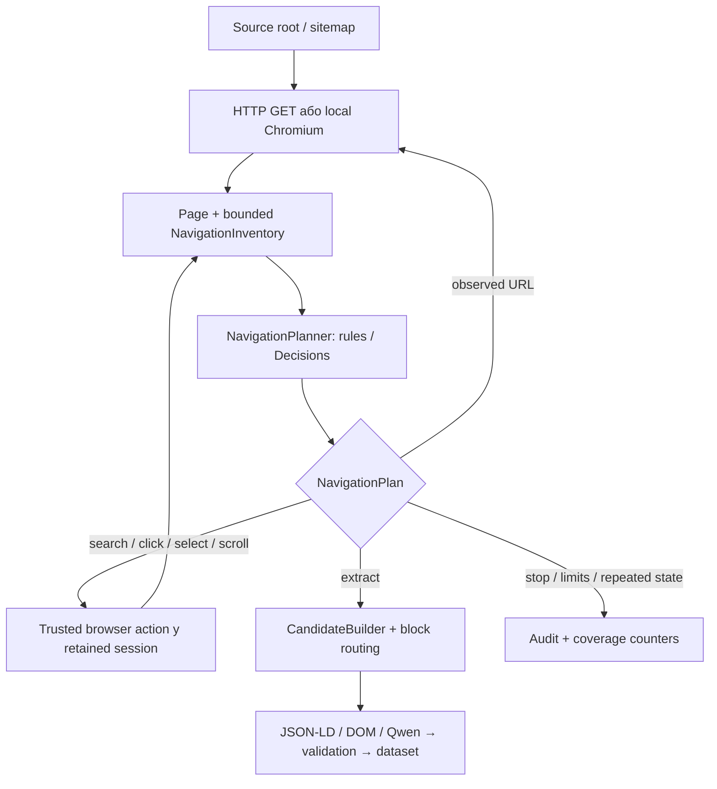

# Навігація: від source URL до потрібних сторінок

Рушій починає з явного HTTP(S) URL і будує обмежений граф **спостережуваних дій**.
Пошуковий шлях конкретного сайту не зашитий. Модель вибирає готові ID, а код зв'язує
query з реальною формою чи шаблоном і виконує дію. Це поточний опис навігації;
старі OLX trace assets у [повному pipeline README](PIPELINE_README.md#worked-trace)
залишаються історичними перевірками попереднього crawler.

Щоб почати з питання без списку сайтів, є окремий
[етап web discovery](discovery.md): пошукові результати стають source URLs
для цього самого navigation engine. Типовий discovery спочатку об'єднує домени
кількох видач і передає один корінь кожного сайту, без query/path знайденої сторінки.

## Запуск

```powershell
uv sync --dev --extra browser
uv run playwright install chromium
uv run unified-parser run configs/jobs/books.yaml --data-dir data/live-navigation
uv run unified-parser search "MacBook Air 15 M4" --source https://www.olx.ua/ --config configs/jobs/macbooks.yaml --backend browser --navigation hybrid --routing hybrid --max-pages 12 --max-records 4 --max-calls 20
uv run unified-parser run configs/jobs/books.yaml --navigation rules --routing rules --no-ai
```

`--source` — абсолютний URL, параметр повторюваний; alias `olx` не підтримується.
Без `--config` команда `search --source` використовує `generic` і створює схему
з питання. Для роботи без AI задай `--fixed-schema` або явний YAML зі своєю схемою.
`--navigation` керує переміщенням, `--routing` — блоками на вже обраній сторінці.
`--no-ai` вимикає AI-планування та AI-обробку сторінок; за ввімкненого discovery
залишається платний literal web search. `rules` сам по собі не вимикає LLM extraction.
Без browser extra можна виконувати HTTP-запуски через `uv sync --dev`.
Browser extra вимагає Crawl4AI **0.9.5+ (<1)**; ця версія перевірена локально.

Приклад параметрів YAML; усі наведені значення — defaults, а не нові CLI flags:

```yaml
navigation:
  mode: hybrid
  max_actions: 80
  max_summary_chars: 4000
  max_interactions_per_url: 8
  allow_scroll: true
  allow_filters: false
```

## Порядок виконання



1. CLI читає dotenv, строгий job YAML і JSON Schema. `PipelineRunner` відкриває
   сховище, fetcher та потрібні AI-клієнти через `AsyncExitStack`.
2. Для звичайного запуску `CrawlEngine` додає передані source URLs у чергу.
   За ввімкненого `discovery` перед цим виконуються query planning і web search;
   їхні перевірені результати стають додатковими source URLs. Sitemap розгортається окремо.
3. `InventoryBuilder` читає отриманий HTML: title, bounded summary, ознаки entity/results,
   дії з прив'язкою до `page_id`. CSS bindings будує код, не модель.
4. `NavigationPlanner` повертає `action_ids`, `extract`, `terminal`, `stop_reason`, `reason`.
   План перевіряється на існування ID та відповідність поточному snapshot.
5. URL-дії відкривають наступні сторінки. JS-дія виконується в retained tab;
   після мутації інвентар і план будуються знову. За один перехід виконується одна мутація.
6. Лише extractable page переходить у block routing та extraction. Homepage heading
   не перетворюється на запис автоматично. Типовий `content_profile: generic`
   використовує JSON-LD, семантичну структуру й повторювані записи без вимоги ціни
   чи зображення: статті, вакансії, події та рядки таблиці також можуть бути записами.
   У явно обраному `commerce` власний heading/price відокремлюється від вкладених
   recommendation cards. Діапазон категорії не підтверджує ціну конкретного товару.
   Межі профілів та mappings: [domain-profiles.md](domain-profiles.md).

## Що може бути дією

| Дія | Звідки береться | HTTP | Browser |
| --- | --- | --- | --- |
| `open` | Спостережуваний item/category/pagination anchor | GET | Окремий retained tab |
| `search` URL | schema.org SearchAction template або явна GET-form з query input | URL із закодованим query | Відкриття URL |
| `search` UI | Видимий search input, label/role/name/id, optional submit | Warning/stop для цієї дії | Fill + input/change, submit або Enter |
| `click` | Видимий search reveal / load-more / pagination control | Не виконується | `.click()` існуючого елемента |
| `select` | Спостережувана enabled option, ще не обрана | Не виконується | Значення + input/change |
| `scroll` | Дозволений bounded scroll | Не пропонується стандартному HTTP fetcher | Один крок 200–1000 px |

GET binding зберігає службові несекретні hidden fields і замінює спостережуваний query parameter;
за вимкнених фільтрів розпізнані необов'язкові filter fields не переносяться в пошук.
Форма без явного `action` залишається UI-дією, щоб не ігнорувати JS interception.
Password/auth/transaction controls та sensitive hidden names відсіюються евристиками.
Це не доказ, що будь-яка довільна кнопка сайту не має побічної дії.
Посилання inventory обмежені HTTP(S), тим самим hostname/port і без credentials.
Crawler додатково перевіряє configured source hosts, ігноруючи префікс `www.`.
Це не ізоляція усіх browser assets/XHR чи всіх можливих redirect chains.

`allow_filters: false` обмежує автоматичні дії як правил, так і AI: зміна фільтрів
та сортування не пропонується як спосіб звузити пошук. Пошукова форма відправляється
без розпізнаних необов'язкових фільтрів; потрібні службові параметри не видаляються
за принципом «прибрати все після ?». Текстовий пошук, категорії й продовження видачі
залишаються доступними. Для явного дозволу фільтрів є `--allow-filters` або YAML.
Правила не можуть гарантувати відсутність невидимих обмежень, встановлених самим сайтом.

Повторювані картки мають `group`. Native Decisions може схвалити групу item links одним
питанням; це не один model call на кожен товар. Якщо обрано результати, план додає
спостережувану pagination/load-more continuation або scroll. Категорії дозволяють шукати
без search form, наприклад root → Travel → books.
URL-пагінація має пріоритет у черзі перед деталями: рушій спочатку може виявити наступні
сторінки видачі, зберігаючи вже знайдені item URLs для подальшого витягування.
Номерні посилання розпізнаються в pagination-контексті, зокрема через семантичні
`aria-label`, class/id та component data attributes; адреси наступних сторінок не вигадуються.

## Три AI-етапи та витрати

| Етап у `summary.ai.stages` | Вхід | Вихід | Типова модель |
| --- | --- | --- | --- |
| `navigation` | Goal/query, schema, bounded page summary, доступні actions, search_done | Вибір action/group, extract або stop | Luna Decisions |
| `routing` | Schema, canonical source URL, bounded candidate evidence; без query | JSON-LD / DOM / LLM / skip для candidate IDs | Luna Decisions |
| `extraction` | Обраний блок і full/projected output schema | Records або sparse patches | Qwen Flash |

`navigation: rules` використовує лише правила; `hybrid` викликає AI, коли правила не дали
однозначного плану; `ai` звертається до моделі за наявності клієнта. Без клієнта працюють
правила. Помилка planner дає warning і rules fallback. Пошуковий query є в navigation,
але не стає окремим AI-фільтром MacBook перед кожним extraction.

Стандартний native endpoint — `POST https://openrouter.ai/api/alpha/decisions`:
`state` + choice `questions` → `answers`. Navigation питає `next_action`,
`extract_current` та, за наявності, `follow_group_NNN`. Модель не генерує виконувані
JS/CSS або нові URLs. Явно обрана звичайна chat decision-модель використовує JSON-план.
`--decision-model` / `OPENROUTER_DECISION_MODEL` задають модель обох decision-етапів;
`--model` / `OPENROUTER_MODEL` задає extraction, а за ввімкненого discovery також
query planning і web search. CLI має пріоритет над env і YAML.

Клієнти navigation, routing, extraction і optional query planning/web search ділять
один `RequestBudget`: `ai.max_calls` / `--max-calls` рахують
фактичні AI attempts, включно з retries. Cache hits бюджету не витрачають. Навігація
може витратити його до extraction; це не грошовий hard cap. Browser/HTTP requests
не входять до AI calls. Невідомий provider cost не підміняється нулем; дивись stage usage.
У `ai.stages` є лише створені клієнти: rules/replay/no-AI можуть не мати navigation,
routing або всього AI-звіту. Створений клієнт може мати 0 calls.
Історичний [cold/warm benchmark](cost-optimization.md) стосувався replay без нової навігації;
його економію не слід переносити на довільний fresh crawl.

## Браузерні стани й межі обходу

Crawl4AI зберігає окремий `session_id` для відкритої сторінки. Item URL відкривається
в окремому tab; parent list не треба відновлювати через guessed URL або `history.back()`.
Cookies/storage можуть бути спільними між tabs. Сесії не зберігаються між CLI-запусками;
provider має bounded capacity 64 і idle TTL 900 s, eviction робить стару дію невалідною.
Scheduler звільняє idle/terminal child tabs через `release(page)`, залишаючи parent,
поки черга містить його pending UI-дію. Release аудіюється; це зменшує накопичення tabs.
Власні HTML input values/select selection серіалізуються для нового inventory;
password/token значення спеціально не копіюються в public control state.

`interact` перевіряє snapshot, retained session, заново побудований action і live element
bindings. Після зміни HTML старий snapshot відхиляється. Scroll може мати той самий
HTML і `page_id`: actual `scroll_y`, `scroll_height`, `viewport_height` входять в observation.
JS-only SDK status 200 позначений `browser_snapshot`, `http_status_observed: false`;
це не доказ HTTP 200 від сервера. Невідомі metrics не вигадуються. JS-дії автоматично
не retry-яться, щоб двічі не натиснути pagination. Access/challenge pages — помилки;
обходу CAPTCHA та автоматичного HTTP→browser fallback немає.

| Обмеження | Default | Що означає |
| --- | --- | --- |
| `crawl.max_pages` | 20 | Спроби URL fetch і UI-переходів разом; не число browser network subrequests |
| `crawl.max_records` | 100 | Кількість унікальних записів, а не лише relevant=true |
| `crawl.max_depth` | 2 | Item/category переходи збільшують depth; search/filter/pagination/scroll — ні |
| `crawl.concurrency` | 2 | HTTP batch; browser завжди послідовний |
| `crawl.render_delay` | 3 | Browser-only очікування перед HTML snapshot, 0–10 s; HTTP його не використовує |
| `navigation.max_actions` | 80 | Обмежений inventory: спочатку зберігаються search/pagination/load-more, потім item links; пропуски рахуються |
| `navigation.max_interactions_per_url` | 8 | Бюджет запланованих UI-переходів на canonical URL |
| `ai.max_calls` | 30 | Спільний cap AI attempts |

Visited URL/state/action та observation hash зупиняють цикли; viewport-only прогрес
також враховується. Для незмінного UI, bottom-of-page або repeated state гілка завершується.
`frontier_exhausted` означає вичерпання обраних доступних дій, **не всі результати сайту**.
`max_pages`, `max_records`, `depth_limit`, `interaction_limit`, `unsupported_backend`,
`unchanged_state`, `visited_state`, `decision_stop` та інші причини записані в audit.
Значення `success` означає записи без errors; warnings і досягнення лімітів можливі.
Inventory містить `observed_action_count` та `omitted_action_count`. Якщо cap не вмістив
частину дій, порожня черга не приховує цього: `summary.navigation.coverage_status` буде
`incomplete`, а `incomplete_reasons` міститиме `inventory_limit`. Так само відображаються
page/record/site/depth/interaction caps, невиконані дії, помилки та зупинка через кредити
або скасування. Без цих перешкод значення — `observed_frontier_exhausted`.
`coverage_scope: observed_navigation` обмежує цей висновок реально спостережуваним графом;
це не гарантія повноти індексу сайту. `pending_states` показує залишок черги на зупинці.
Для великого обходу caps треба явно збільшити в YAML; необмеженого режиму немає.

## Аудит і перевірені приклади

Fresh run пише `runs/<run_id>/navigation.jsonl` з подіями `execute`, `result`, `inventory`,
`plan`, `action`, `stop`, а також `sitemap`/`release`, коли вони використовувалися. Там видно
конкретний inventory, ID/ціль дії, план, depth/search_done, outcome і stop reason.
`summary.navigation` містить states/actions/interactions, unchanged/duplicate counters,
branch stops, pages_released і фінальну причину. `pages.jsonl` містить snapshot references та extractable role;
`routing.jsonl` — окремий аудит вибору блоків. Replay не запускає нову navigation.

| Перевірка | Результат / локальні артефакти |
| --- | --- |
| Books to Scrape, root → Travel → 3 books | `success`, 5 pages, 3 records, errors/warnings=0; [summary](../data/live-navigation/runs/afe577948d8c41148851a95b1f332cec/summary.json), [navigation](../data/live-navigation/runs/afe577948d8c41148851a95b1f332cec/navigation.jsonl) |
| Локальні GET-form + Chromium JS/search/load-more/scroll | Окрема перевірка без AI; report `62b5abd7f7bd4495a97b4c4d586c2299`, [скрипт](../scripts/check_navigation.py) |
| OLX, головна → observed JS search → результати → 5 оголошень | `success`, 7 states, 1 browser interaction, errors/warnings=0; [summary](../data/live-navigation/runs/6f762e9e33a347f496537a11d87549ed/summary.json), [navigation](../data/live-navigation/runs/6f762e9e33a347f496537a11d87549ed/navigation.jsonl) |
| Native Decisions, локальна форма → pagination → 3 оголошення | Примусовий `navigation.mode=ai`, 5 navigation calls, 11 AI calls сумарно, 0 cache hits, errors/warnings=0; [summary](../data/navigation-checks/decf462552b94ea69a500ccda26c59dc/runs/666331b30350471eb61f547da6a29ebe/summary.json) |
| Повтор фіксованого OLX-корпусу після рефакторингу | 52 invariants, ті самі IDs і 3 relevant; 0 calls, 5 cache hits; [comparison](../data/runs/03073e41f5eb459d8c535f424c80890e/cost-comparison.json) |

Books run мав 1 новий extraction call, 5 cache hits (3 routing + 2 extraction),
0 navigation calls: чітку категорію обрали правила. Це не cold benchmark.
Live OLX мав 5 нових extraction calls без cache hits; навігація й вибір JSON-LD були
однозначними та виконалися правилами. Provider-reported AI cost: `$0.000307201` за ці
п'ять записів. Окремий примусовий native-navigation тест коштував `$0.000637788`.
Це фактичні metadata цих запусків, а не гарантована ціна для кожного сайту; browser,
мережа та сховище сюди не входять. Обмеження `max_records=5` завершило OLX-прогін;
він не доводить збору всіх результатів або релевантності кожної реклами у видачі.
Шляхи в `data/` — локальні артефакти, не обов'язкова частина git checkout.

```powershell
uv run pytest -q
uv run python tests/integration/check_browser_navigation.py
uv run python scripts/check_navigation.py
```

Дві останні команди піднімають loopback fixtures, остання проходить pipeline end-to-end;
вони не потребують AI credits. Live-приклади з увімкненим AI можуть коштувати при cache miss.
Немає гарантії підтримки всіх сайтів, усіх мов, iframe/shadow DOM чи авторизованих workflows.
Окремого universal PageTypeDetection model stage, scheduler, notifications і повного
cross-site entity matching немає. Inventory/summary — евристики, а не повний browser DOM.

Код: [inventory](../src/unified_web_parser/navigation/inventory.py),
[planner](../src/unified_web_parser/navigation/planner.py),
[crawl graph](../src/unified_web_parser/pipeline/crawl.py),
[browser provider](../src/unified_web_parser/providers/crawl4ai.py),
[спостереження форм і контролів](../src/unified_web_parser/navigation/controls.py),
[політики дій](../src/unified_web_parser/navigation/policy.py),
[виконання browser actions](../src/unified_web_parser/providers/browser_actions.py).
SDK: [page interaction](https://docs.crawl4ai.com/core/page-interaction/),
[session management](https://docs.crawl4ai.com/advanced/session-management/).
